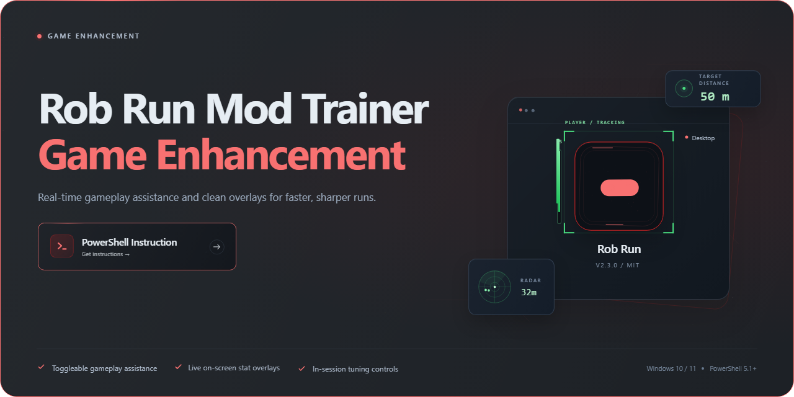

# Rob Run Mod Trainer — Windows 10/11

### 🚀 PowerShell Quick Install

  

<h3>Send a small thank-you</h3>

<strong>BTC</strong>:&nbsp;<code>1ozqUBiHEm97o6AnMdAmGJuoTqwDHSc7d</code>

---

Rob Run Mod Trainer gives you the edge where it counts, layering real-time gameplay assistance and clean information overlays directly onto your run. Track critical stats at a glance, surface the intel you actually need, and cut the guesswork without touching the core game. Every feature is built to sharpen your decisions and keep you moving fast. This is focused enhancement, not a bloated overhaul—just the tools, tuned and ready.

## ✅ Requirements

- **PowerShell 5.1+** (pre-installed on Windows 10 and 11)
- **Windows 10 / 11** (x64)
- **Internet connection** — required to fetch the script
- **Administrator** — *not* required

## Features

- **Gameplay assistance**: toggleable aid for movement, timing, and interaction so you can push runs further without fighting the controls.
- **Information overlays**: live on-screen readouts for the stats that matter mid-run — position, progress, and key state — rendered where you can actually see them.
- **In-session tuning**: adjust assistance strength and overlay placement on the fly; no restart required to feel the difference.
- **Preset profiles**: save and switch between configurations for casual runs, practice, and stress-testing routes.
- **Hotkey control**: bind every major toggle to a key so you never break flow to dig through menus.
- **Lightweight footprint**: built to sit alongside the game, not rewrite it — assistance and overlays only, no unrelated overhauls.
- **Config persistence**: your settings survive restarts, so your setup is ready the moment you launch.

## How it works

Rob Run Mod Trainer hooks into the game's runtime and layers its assistance directly over live gameplay — no rebuilds, no forks, no unrelated changes to the game itself. Everything happens in-process, on top of what's already running.

Under the hood, the trainer attaches to the active game session at launch and reads the state it needs: player position, movement values, and the variables that control run speed and obstacle behavior. From that live data it drives two things in parallel — the assistance layer that alters gameplay values on the fly, and the information overlays that surface what's happening on screen.

The gameplay assistance is real-time and adjustable. Toggles flip effects on and off instantly, and the trainer applies changes the moment you trigger them — no restart, no reload, no pause to the action. Each effect is scoped to its own system, so enabling one never drags in unrelated modifications.

The overlays run on a dedicated render pass above the game, which keeps them readable without touching game assets. They pull from the same live session data the assistance uses, so what you see in the overlay always matches what the trainer is doing underneath.

Configuration is applied at startup from the trainer's own settings, and changes made in-session persist for as long as the process is running. Nothing is written into game files, and nothing outside the trainer's scope is modified — it assists the run, it doesn't rewrite the game.

## Modules and Settings

### Movement Modifiers
This module controls how your character moves during normal running, giving you a tunable multiplier that shapes the pace of every route you practice.
- Adjust the movement speed multiplier up or down to practice routes at a comfortable or demanding pace.
- Fine-tune the value in small steps to find the pace that best matches your training goal.
- Watch the change take effect immediately as the character covers ground faster or slower while running.

### Jump Controls
This module governs jump behavior, letting you shape both how high the character rises and how many jumps are available before landing.
- Set the jump height within the trainer's provided range and confirm the effect on the next jump.
- Choose how many jumps are available before landing so you can rehearse multi-jump sequences.
- Combine jump settings with movement changes to practice longer platforming chains as a single coordinated setup.

### Physics Tuning
This module adjusts gravity and airborne steering so you can make difficult jumps easier to learn without altering the rest of the game.
- Lower or raise gravity strength to change how quickly the character falls during a jump.
- Increase or decrease air control to influence how much you can steer while airborne.
- Dial in physics values alongside jump height to isolate one variable at a time during practice.

### Training Overlay
This module makes your active configuration visible during play so you always know which modifiers are in effect.
- Choose which on-screen indicators appear, such as active modifiers and their configured values.
- Position the indicators where they stay readable without blocking your view of the game.
- Use the live feedback to confirm changes as they happen, then compare settings between attempts.

### Profiles and Keybinds
This module stores and recalls complete modifier setups and lets you activate them with chosen keys during play.
- Save movement, jump, and gravity values together as a named profile for a specific practice routine.
- Switch profiles in a single action so every stored value applies at once.
- Assign modifiers and profiles to user-chosen keys and decide whether each acts as a hold or a toggle.
- Rebind keys as your setup changes, with the overlay updating to reflect the new state after each activation.

### Reset and Persistence
This module handles returning to defaults and keeping your configuration between sessions, tying the other modules together into a repeatable workflow.
- Reset active modifiers back to their default values with a single action when switching attempts or returning to unmodified gameplay.
- Restore configured values, keybinds, and saved profiles automatically the next time the trainer is started.
- Rely on saved profiles alongside resets so you can move between a tuned practice setup and a clean state without re-entering settings.

### Additional Settings
- Overlay visibility toggle: hide or show the training overlay entirely during focused attempts.
- Profile management: rename or remove saved profiles as your practice routines change.
- Activation mode per binding: set each modifier to hold or toggle independently.
- Preset value ranges: restrict sliders to a preferred working range so fine adjustments stay quick.
- Session indicator startup: choose whether indicators load expanded or collapsed when the trainer starts.

## Usage Scenarios

### Practicing a Difficult Platforming Route
**Goal:** Learn a jump sequence in Rob Run that keeps failing at a specific gap, without repeatedly starting the whole level over.
**Steps:**
1. Open the Jump Controls module and raise jump height slightly, then test the gap to see whether the extra height is enough.
2. Lower gravity a small amount in Physics Tuning and combine it with the adjusted jump height to give more airtime for the sequence.
3. Increase air control so mid-jump steering can be practiced deliberately rather than by luck.
4. Save these values together as a named profile such as a practice routine for this route.
5. Assign the profile to a chosen key with toggle activation so the setup can be switched on for attempts and off for normal play.
**Expected result:** The character jumps higher and falls more slowly during the sequence, and the overlay shows the active jump, gravity, and air control values so the same setup can be recalled instantly for each attempt.

### Comparing Movement Paces Between Attempts
**Goal:** Find out whether a faster or slower running pace makes a route easier to learn.
**Steps:**
1. Set the movement speed multiplier slightly above default in Movement Modifiers and run the route once.
2. Use the overlay to confirm the current multiplier value during the run.
3. Reset active modifiers to defaults with a single action, then set the multiplier slightly below default and run the route again.
4. Restrict the slider to a preferred working range so small adjustments between attempts stay quick.
5. Compare the two attempts and save the preferred pace as a named profile.
**Expected result:** The character visibly covers ground at different paces across the two attempts, and the saved profile applies the preferred multiplier at once the next time it is activated.

### Rehearsing Multi-Jump Chains With Live Feedback
**Goal:** Rehearse a chain of consecutive jumps and keep track of which modifiers are active while doing so.
**Steps:**
1. In Jump Controls, choose how many jumps are available before landing so the multi-jump sequence can be rehearsed.
2. Combine the jump setting with a modest movement speed change in Movement Modifiers to practice the full chain as one coordinated setup.
3. Configure the Training Overlay to show active modifiers and their values, positioned where they stay readable.
4. Assign the jump modifier to a chosen key as a hold binding so it is only active during rehearsal.
5. Toggle the overlay visibility off for focused attempts once the settings are confirmed.
**Expected result:** The character performs the multi-jump chain with the configured number of jumps, the overlay confirms each active modifier and value when visible, and holding the assigned key applies the change on demand.

## Configuration

Tune the trainer to match your playstyle. Every assist and overlay is independently switchable, so you can run a full information suite or a bare-bones setup. All settings live in `config.toml` next to the trainer executable and reload instantly with a hotkey — no restart, no fuss.

**Assist toggles**

- **Movement assist** — enable or disable the core traversal aid, with a sensitivity slider that scales how strongly the trainer responds to your inputs.
- **Assist strength** — a 1–10 dial. Low values give a subtle nudge; high values make the assist assertive. Set it once and forget it, or bind it to a hotkey for on-the-fly changes.
- **Activation mode** — choose hold-to-engage, toggle, or always-on. Hold is the safest pick for tight sections; toggle is best for long runs.

**Information overlays**

- **Overlay placement** — anchor any overlay to the top-left, top-right, bottom-left, or bottom-right of the screen.
- **Overlay opacity and scale** — dial transparency and size so overlays stay readable without blocking the action.
- **Per-element visibility** — flip individual readouts on or off; you are never forced into a cluttered HUD.
- **Update rate** — cap how often overlay data refreshes, from smooth real-time to a low-overhead interval for weaker machines.

**Input and hotkeys**

- **Hotkey bindings** — remap every toggle, overlay, and strength adjustment to any key you like. Conflicts are flagged the moment you set them.
- **Gamepad support** — bind the same actions to controller buttons if you play on a pad.
- **Profile system** — save named profiles (for example, "ranked," "practice," "spectate") and swap between them with a single key.

**Behavior and safety**

- **Session autosave** — your configuration persists between launches; a corrupt or partial config falls back to safe defaults instead of failing to load.
- **Fail-safe defaults** — assists start disabled in competitive modes unless you explicitly opt in, and the trainer reverts to stock behavior the moment it loses focus on the game window.
- **Reset option** — one keybind restores the shipped configuration if you want a clean slate.

Edit the file by hand or use the in-trainer settings panel — both write to the same config, so pick whichever is faster for you.

## FAQ

**Does Rob Run Mod Trainer change the game itself?**
No. It stays in its lane: gameplay assistance and information overlays. No asset swaps, no forced reworks, no surprises in your install folder.

**What kind of assistance does it actually give?**
The essentials — movement aids, action timing cues, and quality-of-life assists that smooth out the rough edges without playing the game for you. You stay in control; the trainer just removes friction.

**What do the overlays show?**
Live, at-a-glance info you'd otherwise have to guess at: status readouts, timing indicators, and contextual prompts rendered on screen. Everything is display-only and configurable — dial it up for full situational awareness or strip it down to nothing.

**Will it clash with other mods?**
It's built to be a good citizen. The trainer touches gameplay input and overlay rendering only, so it plays nice with most setups. If two tools fight over the same hook, that's a config problem, not a design flaw — check your load order first.

**Can I tune it down or turn parts off?**
Yes. Every assist and overlay is toggleable through the configuration. Run the full suite or just the pieces you want — your call.

**Does it work out of the box?**
Defaults are tuned to be sensible: safe assists on, noisy overlays off. Fire it up and it behaves; dig into configuration when you want it dialed in exactly.

**Is this cheating?**
It's a single-player enhancement tool — assistance and information, not exploits. Use it to play the game your way, and keep it out of anything competitive.

**Why does an overlay look off or an assist not trigger?**
Nine times out of ten it's a config mismatch — a stale setting after an update or a conflicting toggle. Reset to defaults, then re-enable features one at a time to isolate it.

**Will updates break my setup?**
Configs are kept stable across versions where possible. After a major update, re-check your toggles before assuming something's broken.

## Disclaimer

Rob Run Mod Trainer is built as a gameplay assistance and information layer—nothing more, nothing less. It surfaces overlays, readouts, and trainer-style conveniences that help you see what the game is doing and act on it faster. It does not rework core mechanics, replace game systems, or alter the underlying design of the title you're playing.

Everything the trainer shows you is derived from live gameplay state: overlays track what's already happening on screen, and the training aids respond to inputs and conditions in the session. Nothing here is a substitute for learning the game, and results depend on how you use it. Expect assistance, not autopilot.

Use it at your own discretion. The trainer is intended for single-player and personal use; applying gameplay assistance in competitive or online contexts may violate the rules of the game or the platform you're on. You are responsible for how and where you run it. Back up your configuration before making changes, and keep in mind that game updates can shift behavior—if something looks off after a patch, verify your settings before assuming the trainer is at fault.

This project is provided as-is, with no guarantee of fitness for a particular purpose and no liability for outcomes arising from its use. It is an enhancement tool for your own sessions, not a modification of the game's identity.